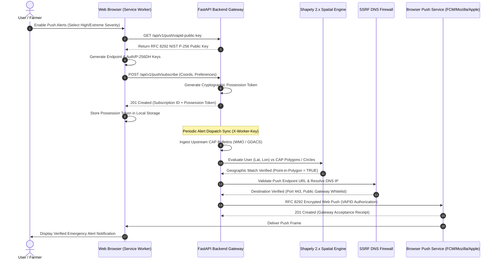
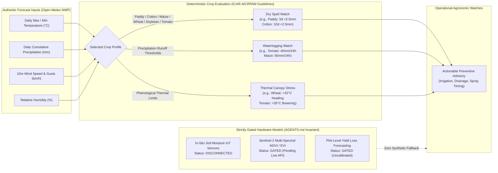

# SkyGuard — Weather Alerts & Climate Intelligence Platform

> **Predict Weather. Understand Risk. Stay Prepared.**  
> A unified, real-time public weather intelligence, worldwide disaster alert, and verified emergency warning platform with a strictly-gated Farmer Mode.

[](https://github.com/PiduguShivaram/SKYGUARD/actions/workflows/ci.yml)
[](https://fastapi.tiangolo.com)
[](https://nextjs.org)
[](https://www.typescriptlang.org)
[](https://www.python.org)
[](https://playwright.dev)
[](docs/CORE_MODULE_AUDIT.md)
[](LICENSE)

---

## Executive Summary

### Problem Statement
The lack of a unified, reliable, location-specific weather and disaster intelligence platform makes it difficult for individuals, communities, and agricultural producers to anticipate impending environmental hazards and take timely preventive actions. Existing consumer apps frequently mix synthetic simulated forecasts with real warnings, invent arbitrary risk scores, or obscure authoritative meteorological sources.

### Solution
**SkyGuard** is a production-hardened environmental intelligence platform that unifies Numerical Weather Prediction (NWP), authoritative international Common Alerting Protocol (CAP) emergency warnings, disaster event monitoring, and crop-specific agroclimatic risk analysis. Designed with an unwavering commitment to data authenticity, SkyGuard enforces a strict zero-fabrication contract, cryptographic Web Push security, and scientific transparency.

---

## Absolute Data Integrity Invariants

SkyGuard operates under a non-negotiable architectural contract governed by [`AGENTS.md`](AGENTS.md):

1. **Zero Synthetic / Placeholder Live Data**: Never render mock charts, demo alerts, hand-entered temperatures, synthetic soil moisture, or fabricated probabilities in production mode.
2. **Explicit Attribution & Provenance**: Every observation, forecast curve, and emergency bulletin carries its upstream provider, model type, retrieval timestamp, timezone, and grid coordinate offset.
3. **Categorical Separation**: Strict visual and schema separation between:
   - **Authoritative Official Warnings** (e.g., WMO SWIC Member States, NDMA, State Authorities)
   - **NWP Model Forecasts** (e.g., Open-Meteo multi-model ECMWF IFS, GFS, ICON)
   - **Deterministic Derived Risk Indicators** (transparent physical heuristics, prominently labeled `EXPERIMENTAL`)
   - **Agrometeorological Advisories** (crop vulnerability watches based on published ICAR-AICRPAM guidelines)
   *An experimental indicator or forecast model is never labeled as an official government warning.*
4. **Honest Failure & Unavailability**: If an upstream agency or feed is degraded, down, or rate-limited, SkyGuard displays an actionable unavailability state. An empty response from a provider is **never** presented as *"No warnings / All Clear / Safe"*.
5. **No Hallucinated Science or Hardware Gating**: In-situ IoT soil sensors, plot-level yield prediction models, and Sentinel-2 satellite NDVI feeds remain strictly **GATED** or **DISCONNECTED** until live calibrated telemetry is provisioned.

---

## System Architecture

SkyGuard separates client rendering from server-side ingestion and cryptographic push operations. All external meteorological and disaster endpoints are proxied asynchronously through FastAPI with strict timeouts, retries, and data normalization.

```mermaid
flowchart TD
    subgraph Client["Frontend Client (apps/web - Next.js 14 App Router)"]
        UI_Search["Geocoding Autocomplete"]
        UI_Weather["24-Hour NWP SVG Curves & 7-Day Forecast"]
        UI_Alerts["Worldwide CAP Advisories & GDACS Feed"]
        UI_Risk["Deterministic Scientific Risk Gauges"]
        UI_Farmer["Gated Farmer Mode (6 Crop Profiles)"]
        UI_Push["Web Push Subscription & Preference Modal"]
    end

    subgraph Gateway["Backend Service (services/api - FastAPI & Python 3.12)"]
        Router["Async API Router (/api/v1)"]
        Geo_Engine["Shapely 2.x Point-in-Polygon Engine"]
        SSRF_Guard["DNS-Resolving SSRF Defense Guard"]
        VAPID_Service["RFC 8292 NIST P-256 VAPID Engine"]
        Risk_Engine["Deterministic Agromet & Hazard Engine"]
    end

    subgraph Upstream["Upstream Authoritative Providers & Scientific Models"]
        OM["Open-Meteo Multi-Model Ensemble\n(ECMWF IFS, GFS, ICON)"]
        WMO["WMO Severe Weather Information Centre\n(SWIC CAP 1.2 XML Feeds)"]
        GDACS["UN OCHA & European Commission GDACS\n(Multi-Hazard Disaster GeoJSON)"]
        AH["Alert-Hub.org International Emergency Stream\n(Aggregated CAP Alerts)"]
        ICAR["ICAR-AICRPAM & NDMA / IMD\n(Agrometeorological Guidelines)"]
    end

    UI_Search -->|HTTP GET /locations| Router
    UI_Weather -->|HTTP GET /weather| Router
    UI_Alerts -->|HTTP GET /alerts/global| Router
    UI_Risk -->|HTTP POST /risk/evaluate| Router
    UI_Farmer -->|HTTP POST /farmer/watch| Router
    UI_Push -->|HTTP POST /push/subscribe| Router

    Router --> OM
    Router --> WMO
    Router --> GDACS
    Router --> AH
    Risk_Engine -.-> ICAR
    Router --> Geo_Engine
    Router --> SSRF_Guard
    Router --> VAPID_Service
```



---

## End-to-End Push Verification & Geospatial Workflow

SkyGuard implements high-security, possession-token-protected Web Push notifications with strict polygon geofencing. Local alerts never trigger notifications in other cities within the same country unless the user explicitly opts into country-wide bulletins.



---

## Agrometeorological Heuristics & Hardware Gating Workflow

In Farmer Mode, operational crop watches are computed purely from authentic 7-day Numerical Weather Prediction forecasts. Future and unconnected features remain strictly gated to protect farmers from fabricated telemetry.



---

## Five Core Modules

| Module | Purpose | Data Source / Standard | Security & Integrity Hardening |
|---|---|---|---|
| **1. Real-Time Forecasts & Verified Charts** | Global location search, 7-day forecast, high-contrast 24-hr SVG trend curves | Open-Meteo Multi-Model Ensemble (ECMWF, GFS, ICON) | Explicit requested vs. grid coordinates, zero fake zero-fill defaults, timezone preservation |
| **2. Global Weather & Disaster Alerts** | Worldwide multi-hazard disaster events and official CAP emergency warnings | WMO SWIC, GDACS (UN OCHA), Alert-Hub.org | Strict ISO country filtering (no China leaks for IN), original CAP severity preservation, no false "All Clear" |
| **3. Deterministic Risk Assessment** | Quantitative hazard detection for extreme heat, heavy downpours, and wind squalls | IMD, WMO, NDMA scientifically documented physical thresholds | Transparent deterministic calculations, prominently labeled `EXPERIMENTAL`, boundary-tested |
| **4. Web Push Notification Center** | Precision-targeted emergency bulletins delivered via browser service workers | RFC 8292 VAPID, Browser Push Gateways (FCM, Mozilla, Apple) | Shapely 2.x Point-in-Polygon matching, SSRF defense with DNS IP resolution, possession-token anti-takeover |
| **5. Gated Farmer Mode** | Crop-specific weather advisories for 6 major crops with phenological stage tracking | ICAR-AICRPAM, FAO agronomic research guidelines | Unconnected IoT sensors and satellite indices are strictly `GATED` / `DISCONNECTED`; no hallucinated yield predictions |

---

## Comprehensive Testing & Verification Matrix

SkyGuard includes a multi-layered automated verification pipeline spanning unit tests, integration suites, concurrency stress tests, dependency vulnerability audits, and multi-viewport browser journeys.

### 1. Multi-Job GitHub Actions CI Pipeline (`.github/workflows/ci.yml`)

The repository runs 5 automated CI jobs on every pull request and push:

| CI Job Name | Scope & Tools | What It Verifies |
|---|---|---|
| `backend-unit-and-security` | Python 3.12, Pytest, Shapely 2.x | 36 offline unit, risk engine, farmer engine, geospatial, SSRF, and stress tests |
| `backend-dependency-audit` | `pip-audit`, PyPI / OSV databases | Scans all 13 backend packages for known CVEs (**0 vulnerabilities found**) |
| `frontend-typescript-check` | Node 20, pnpm 9, TypeScript 5.6+ | Strict `tsc --noEmit` across all App Router components, hooks, and types |
| `frontend-production-build` | Next.js 14.2.35 (Security Patched) | Clean production bundling with tree-shaking, static optimization, and asset compilation |
| `e2e-playwright-verification` | Headless Chromium, Python Playwright | 5 end-to-end browser user journeys against live FastAPI & Next.js background daemons |

### 2. Five Headless Playwright Browser Suites (`tests/test_browser_e2e.py`)

1. `test_playwright_public_mode_multi_location`: Multi-city search, geocoding resolution, NWP model disclaimer, 24-hr authentic SVG temperature curve, and Phase 3 derived risk cards.
2. `test_playwright_farmer_mode_crop_stress`: Crop switching (`Cotton`, `Maize`, `Tomato`), sowing date age calculation, ICAR advisory text, and verification that unconnected hardware is marked `DISCONNECTED` and `GATED`.
3. `test_playwright_push_notification_settings`: Modal opening, RFC 8292 VAPID key fetch, Country-Wide Emergency Bulletins toggle, and data integrity notices.
4. `test_playwright_global_alerts_and_modal_inspection`: WMO SWIC & GDACS multi-hazard feed switching, CAP XML advisory inspection, and verification that no fake "All Clear" badges appear.
5. `test_playwright_mobile_responsive_layout`: Responsive rendering on Mobile (375x667) and Tablet (768x1024) viewports without horizontal clipping or broken components.

### 3. Concurrency Stress & Pathological Security Hardening (`test_stress_and_hardening.py`)

- **Concurrent Async Health Queries**: 50 concurrent requests verified with zero connection drops.
- **Pathological CAP Polygons**: Rejects self-intersecting, degenerate, empty, and 360-vertex stress polygons without worker crashes.
- **Degenerate CAP Circles**: Rejects negative radii, non-numeric coordinate tuples, and out-of-bounds coordinates.
- **SSRF Injection Vectors**: Blocks private IP addresses (`127.0.0.1`, `10.0.0.0/8`, `192.168.0.0/16`, `169.254.169.254`), non-standard ports (`http://localhost:8080`), and non-whitelisted schemes.
- **Agroclimatic Monte Carlo Scenarios**: 50 randomized extreme weather conditions validated across all 6 crop profiles without unhandled exceptions.
- **Physical Boundary Anomalies**: Evaluated from -20°C deep freeze to +52°C extreme heatwave conditions.

---

## Quickstart Guide

### Prerequisites
- **Node.js** v18+ & **pnpm** (or npm)
- **Python** 3.12+ (or 3.11+)
- Internet connectivity (to query upstream Open-Meteo, GDACS, and WMO feeds)

### 1. Clone the Repository
```bash
git clone https://github.com/PiduguShivaram/SKYGUARD.git
cd SKYGUARD
git checkout feature/production-hardening-and-security
```

### 2. Start the FastAPI Backend Service
```bash
cd services/api
python -m venv .venv

# On Windows:
.\.venv\Scripts\activate
# On Linux/macOS:
# source .venv/bin/activate

pip install -r requirements.txt
uvicorn services.api.app.main:app --host 127.0.0.1 --port 8000 --reload
```
*Backend API runs at `http://127.0.0.1:8000` (Interactive OpenAPI Swagger documentation: `http://127.0.0.1:8000/docs`).*

### 3. Start the Next.js Frontend Application
In a separate terminal:
```bash
cd apps/web
pnpm install
pnpm dev
```
*Frontend application will be accessible at `http://localhost:3000`.*

---

## Verification Commands

Run the following verification commands to inspect system health locally:

```bash
# 1. Run offline Pytest test suite (36 tests)
pytest services/api/tests/ -v -m "not live"

# 2. Run live upstream smoke tests (queries genuine WMO, GDACS, Open-Meteo feeds)
pytest services/api/tests/ -v -m "live"

# 3. Run dependency vulnerability audit (0 vulnerabilities)
pip-audit -r services/api/requirements.txt

# 4. Run strict frontend TypeScript check
pnpm --filter web exec tsc --noEmit

# 5. Build Next.js production bundle
pnpm --filter web build

# 6. Execute all 5 Playwright automated browser test journeys
python -u tests/test_browser_e2e.py
```

---

## API Specification Summary

| Endpoint | Method | Scope | Source / Security |
|---|---|---|---|
| `/health` | GET | Internal service health and upstream connectivity status | Open-Meteo, GDACS, WMO, Alert-Hub |
| `/api/v1/locations` | GET | Global geocoding search with administrative boundary metadata | Open-Meteo Geocoding API |
| `/api/v1/weather` | GET | 7-day hourly and daily multi-model NWP forecast | Open-Meteo Multi-Model Ensemble |
| `/api/v1/alerts/global` | GET | Aggregated CAP official warnings and global disaster events | WMO SWIC, GDACS, Alert-Hub.org |
| `/api/v1/alerts/gdacs` | GET | Multi-hazard natural disaster events (cyclone, flood, quake) | UN OCHA & European Commission |
| `/api/v1/alerts/wmo` | GET | Official severe weather CAP 1.2 XML bulletins | WMO Member State Meteorological Agencies |
| `/api/v1/alerts/alerthub` | GET | International emergency CAP bulletin stream | Alert-Hub.org |
| `/api/v1/risk/evaluate` | POST | Deterministic scientific weather risk indicators | SkyGuard Risk Assessment Engine |
| `/api/v1/farmer/watch` | POST | Crop-specific agromet watches and hardware gating | ICAR-AICRPAM Guidelines |
| `/api/v1/push/vapid-public-key` | GET | Retrieve RFC 8292 NIST P-256 VAPID public key | SkyGuard VAPID Key Service |
| `/api/v1/push/subscribe` | POST | Register or update Web Push subscription | Browser Push Service Gateway |
| `/api/v1/push/test` | POST | Send diagnostic operational test notification | SkyGuard Diagnostics |
| `/api/v1/push/dispatch-sync` | POST | Periodic worker alert matching and dispatch | Internal Worker (`X-Worker-Key`) |

---

## Audit Documentation & Evidence

For line-by-line verification evidence, scoring rubrics, security audit findings, and mathematical calculations across all five core modules, consult the official audit report:
[docs/CORE_MODULE_AUDIT.md](docs/CORE_MODULE_AUDIT.md)

---

## License & Ethical Commitment

SkyGuard is released under the **[MIT License](LICENSE)**.

SkyGuard is dedicated to ethical public interest computing. All weather intelligence, emergency warnings, and agricultural risk calculations prioritize data authenticity, user privacy, and algorithmic transparency above commercial gamification or synthetic simulation.
