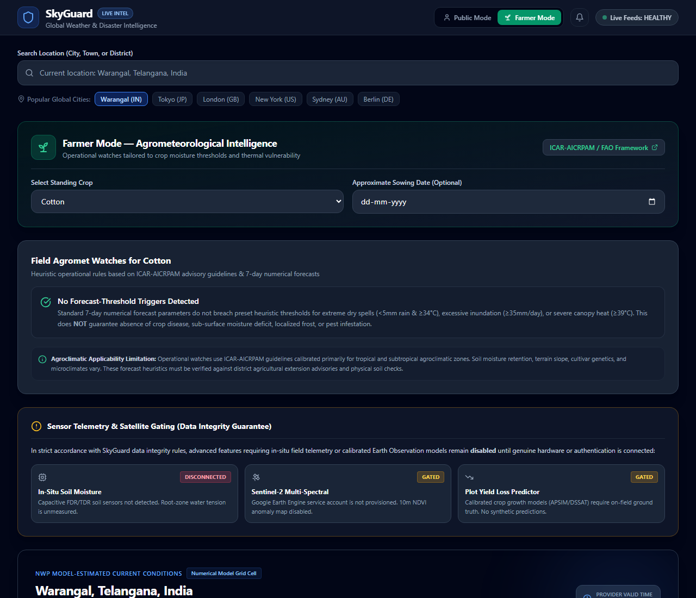

# SkyGuard 🛡️ — Weather Alerts & Climate Intelligence Platform

> **A real-time public weather intelligence, worldwide disaster alert, and verified emergency warning platform with a strictly-gated Farmer Mode.**

[](LICENSE)
[](https://fastapi.tiangolo.com)
[](https://nextjs.org)
[](https://www.typescriptlang.org)
[](https://www.python.org)
[](https://playwright.dev)

---

## 🌟 Overview

SkyGuard is built from the ground up on an **absolute zero-fabrication contract**. It provides genuine, server-side proxied environmental intelligence without ever rendering fake live metrics, placeholder charts, demo alerts, or synthetic AI hallucinations.

### Core Capabilities

1. **Live Global Weather & NWP Forecasts**:
   - Geocoding and 7-day hourly/daily forecasts via Open-Meteo multi-model Numerical Weather Prediction (ECMWF IFS, GFS, ICON).
   - High-contrast 24-hour SVG trend curves for temperature, rain probability, and wind gusts.
   - Comprehensive provenance metadata: requested vs. grid coordinates, timezone offset, elevation, and provider attribution.

2. **Worldwide Emergency & Disaster Alerts (Phase 2)**:
   - **WMO SWIC**: Official Common Alerting Protocol (CAP) bulletins from national meteorological services worldwide (2,100+ active warnings).
   - **GDACS**: Real-time multi-hazard disaster events (tropical cyclones, floods, earthquakes, droughts, volcanic activity, wildfires) from UN OCHA & European Commission.
   - **Alert-Hub.org**: International unfiltered emergency CAP RSS stream.
   - Proximity search with Haversine distance calculations without invented polygon boundaries.
   - **Honest Data Integrity Policy**: If no alerts are active for a region, SkyGuard explicitly notes that absence of warnings does **not** signify "All Clear" or "No Danger".

3. **Deterministic Scientific Risk Indicators (Phase 3)**:
   - Experimental derived indicators based on physical IMD, WMO, and NDMA thresholds (Heavy Rainfall, Extreme Heatwaves, High Wind Squalls).
   - Strict categorical separation: derived heuristics are prominently labeled `EXPERIMENTAL` and never masquerade as official warnings.

4. **Privacy-Preserving Web Push Notifications (Production Hardened)**:
   - Possession-bound browser Web Push subscriptions via VAPID RFC 8292.
   - **Shapely 2.x Point-in-Polygon Engine**: Strict geometric verification against official CAP polygons. Localized alerts never trigger unverified push notifications in other cities within the same country unless the user explicitly opts in to Country-Wide Emergency Bulletins.
   - **SSRF Defense with DNS Resolution**: Validates HTTPS on port 443 against whitelisted gateways (`fcm.googleapis.com`, `*.push.services.mozilla.com`, `*.push.apple.com`, `*.notify.windows.com`) and resolves IPs to prevent private/loopback/link-local SSRF.
   - **Anti-Takeover Security**: Modifications to active subscriptions strictly require possession token verification.
   - **Worker Authorization Key**: Synchronization dispatches (`/api/v1/push/dispatch-sync`) require internal authorization (`X-Worker-Key`).
   - **Delivery Guarantees**: Distinguishes Gateway Acceptance (`GATEWAY_ACCEPTED`) from client display, records gateway receipts, executes exponential backoff retries for transient errors, and automatically deactivates permanently dead endpoints (HTTP 410/404).

5. **Gated Farmer Mode (Phase 4)**:
   - Dedicated agrometeorological mode tailored to crop moisture thresholds and thermal vulnerability for Paddy, Cotton, Maize, Wheat, Soybean, and Tomato.
   - Computes operational watches (extended dry spells, waterlogging/drainage needs, crop canopy thermal stress) referencing ICAR advisory guidelines.
   - **Strict Hardware Gating**: In-situ soil moisture sensors (`DISCONNECTED`), Sentinel-2 multi-spectral NDVI (`GATED`), and plot-level yield loss models (`GATED`) remain disabled until genuine hardware or authenticated services are provisioned.

---

## 🏛️ System Architecture

```text
┌─────────────────────────────────────────────────────────────────────────────────┐
│                                    apps/web                                     │
│          Next.js 14+ (App Router) · React 18 · TypeScript · Tailwind CSS        │
│  ┌───────────────────────┐  ┌──────────────────────┐  ┌──────────────────────┐  │
│  │   Search & Geocoding  │  │   Weather & Curves   │  │   Global Alerts &    │  │
│  │      Autocomplete     │  │  (Authentic NWP SVG) │  │  Gated Farmer Mode   │  │
│  └───────────┬───────────┘  └──────────┬───────────┘  └──────────┬───────────┘  │
└──────────────┼─────────────────────────┼─────────────────────────┼──────────────┘
               │                         │                         │
               │ HTTP / JSON             │                         │
               ▼                         ▼                         ▼
┌─────────────────────────────────────────────────────────────────────────────────┐
│                                  services/api                                   │
│                     FastAPI · Pydantic v2 · HTTPX (Async Client)                │
│  ┌─────────────────────┐  ┌─────────────────────┐  ┌─────────────────────────┐  │
│  │  Open-Meteo Client  │  │  Scientific Risk    │  │ Multi-Provider Alerts   │  │
│  │  (/weather, /geo)   │  │  Engine (/risk)     │  │ (/alerts/global, /wmo,  │  │
│  │                     │  │                     │  │  /gdacs, /alerthub)     │  │
│  └───────────┬─────────┘  └──────────┬──────────┘  └─────────────┬───────────┘  │
└──────────────┼───────────────────────┼───────────────────────────┼──────────────┘
               │                       │                           │
               ▼                       ▼                           ▼
┌─────────────────────────────┐ ┌──────────────┐ ┌────────────────────────────────┐
│         Open-Meteo          │ │   ICAR /     │ │      WMO SWIC · GDACS        │
│   NWP Models & Geocoding    │ │   NDMA / WMO │ │   Alert-Hub.org Global Feeds   │
│  (ECMWF, GFS, ICON IFS)     │ │  Thresholds  │ │ (CAP XML, GeoJSON, RSS Feeds)  │
└─────────────────────────────┘ └──────────────┘ └────────────────────────────────┘
```

---

## 📸 Screenshots

| Public Mode Forecast & Derived Risks | Gated Farmer Mode Agrometeorology |
|---|---|
|  |  |

---

## 🚀 Quickstart Guide

### Prerequisites
- **Node.js** v18+ & **pnpm** (or npm)
- **Python** 3.11+
- Genuine internet connectivity (to query live upstream weather & disaster feeds)

### 1. Clone & Setup Repository
```bash
git clone https://github.com/PiduguShivaram/SKYGUARD.git
cd SKYGUARD
```

### 2. Start FastAPI Backend Service
```bash
cd services/api
python -m venv .venv

# On Windows:
.\.venv\Scripts\activate
# On Linux/macOS:
# source .venv/bin/activate

pip install -r requirements.txt
uvicorn services.api.app.main:app --host 127.0.0.1 --port 8000 --reload
```
*Backend API will be running at `http://127.0.0.1:8000` (Interactive docs: `http://127.0.0.1:8000/docs`).*

### 3. Start Next.js Frontend Application
In a separate terminal:
```bash
cd apps/web
pnpm install
pnpm dev
```
*Frontend application will be accessible at `http://localhost:3000`.*

---

## 🧪 Testing & Verification

SkyGuard includes a multi-tier test matrix ensuring both offline calculation correctness and real live upstream provider health:

### Run Pytest Test Suite
```bash
# In services/api with virtualenv activated:
pytest -v
```
*Executes all 19 unit and integration tests across schemas, risk engines, farmer logic, and live upstream providers.*

### Run Live Upstream Smoke Verification
```bash
python scripts/check_live.py
```
*Queries genuine live endpoints for Open-Meteo, GDACS, and WMO SWIC to verify connectivity, schema parsing, and latency.*

### Run Playwright Browser E2E Test
```bash
python tests/test_browser_e2e.py
```
*Drives a headless browser through location search, weather rendering, derived risk analysis, farmer mode toggling, and data integrity invariant assertions.*

---

## 📋 API Endpoints Summary

| Endpoint | Method | Description | Upstream Data Source |
|---|---|---|---|
| `/health` | GET | Internal service health and upstream diagnostics | Open-Meteo, GDACS, WMO, Alert-Hub |
| `/api/v1/locations` | GET | Geocoding city search with auto-complete | Open-Meteo Geocoding API |
| `/api/v1/weather` | GET | 7-day hourly & daily NWP forecast | Open-Meteo Multi-Model Ensemble |
| `/api/v1/alerts/global` | GET | Aggregated CAP warnings & disaster events | WMO SWIC, GDACS, Alert-Hub.org |
| `/api/v1/alerts/gdacs` | GET | Multi-hazard global disaster events GeoJSON | UN OCHA & European Commission |
| `/api/v1/alerts/wmo` | GET | Official severe weather CAP bulletins | WMO Member State NMHS agencies |
| `/api/v1/alerts/alerthub` | GET | Aggregated international emergency CAP stream | Alert-Hub.org |
| `/api/v1/risk/evaluate` | POST | Deterministic scientific weather risk heuristics | SkyGuard Risk Assessment Engine |
| `/api/v1/farmer/watch` | POST | Crop-specific watches and hardware gating | ICAR Agromet Advisory Guidelines |

---

## 📜 Absolute Data Integrity Invariants

1. **Zero Fake Live Data**: No placeholder charts, simulated soil moisture, or synthetic probabilities.
2. **Explicit Provenance**: Every metric displays its origin provider, model type, retrieval timestamp, and timezone.
3. **Categorical Separation**: Clear visual and architectural distinction between official warnings, model forecasts, and experimental risk heuristics.
4. **Honest Failure Handling**: Clear unavailability notices when an upstream provider is down; empty alert feeds are never disguised as "All Clear".

---

## 📄 License

This project is licensed under the [MIT License](LICENSE).
